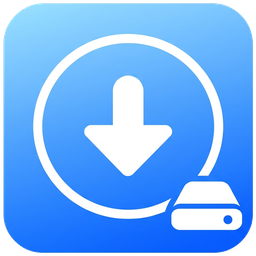

# Legacy IPA Manager for Windows

<p>
  
  
</p>

**IPA Library, Compatibility Analyzer & Multi-Device Installer for Legacy iOS Devices**

[English](README.md) | [简体中文](README.zh-CN.md)

**Documentation:** [User Guide](USER-GUIDE.md) · [使用指南](使用指南.md) · [IdeviceIndex Component README](IdeviceGui/prototype/IdeviceIndex/README.md) · [Release Notes](RELEASE_NOTES.md)

> A C# / WPF (.NET 10) Windows desktop tool built for managing large local `.ipa` collections and installing apps onto jailbroken legacy iOS devices (with AppSync Unified) over USB.
>
> Unofficial third-party tool. Not affiliated with Apple Inc.

---

## Core Strengths

### 1. Intelligent Multi-Device Installation Queues
- **True Per-Device Concurrency**: Each connected device runs an independent serial pump with zero cross-device locking — verified installing on 4 devices simultaneously.
- **Instant Enqueue & Smart Scheduling**: Tasks enqueue instantaneously and sort automatically by **Uninstalls first -> largest `PeakBytes` (`compressed + uncompressed`) descending -> FIFO**.
- **Pre-Flight Staging & Space Protection**: Uses an isolated `AfcHelper.exe` process to purge `/PublicStaging` and measure real free storage before upload; suspends safely on low space instead of failing mid-install.
- **Strict 3-Part Verification**: Combines CLI exit code, `stderr` scan, and up to 3 `ideviceinstaller list --xml` readbacks to prevent false successes (including iOS 6/7 exit-code-0 uninstall quirks).
- **Disconnect Auto-Resume & Safe Cancel**: Automatically pauses on USB disconnect and resumes after a configurable stability window; cancelling during transfer kills the process tree, while cancelling after installation begins waits for completion and automatically uninstalls cleanly.

### 2. High-Scale Library (50,000+ IPAs) & Deep Offline Parsing
- **Incremental Reconciliation**: SQLite (`WAL`) + NTFS `FileId` / size / mtime tracking; deep-parses `Info.plist`, ZIP uncompressed breakdown, Mach-O architectures (`armv6`-`arm64`), CgBI-restored PNG icons, and package origin (`SC_Info` Original / `embedded.mobileprovision` Re-signed / Decrypted).
- **Fast Navigation**: Same-`BundleId` grouping, **0-9 / A-Z / #** quick jump bar (with Chinese Pinyin initials), `Shift + Mouse Wheel` horizontal scrolling, user custom groups (`data\groups.json`), per-device library scroll memory, and automatic missing-file detection/dimming.

### 3. Hardware-Accurate Compatibility & Rule Filtering
- **100% Offline Screen-Tier Analysis**: Extracts highest supported screen tier (`OG 3.5"`, `3.5"`, `4"`, `4.7"`, `iPad Retina`) directly from internal IPA launch images, storyboards, and icon dimensions.
- **3-State Compatibility & Multi-Group Filter**: Instant switching between **Off / Installable / Adapted** for the active device (`HardwareModel` primary + `ProductType` fallback), plus composable AND/OR advanced filters by version, size, architecture, state, and origin.
- **Live Installed Matching**: Highlights exact-version matches (green + check) and alternate-version matches (light blue) directly in the library grid.

### 4. Keyboard-First Desktop UX & Portable Isolation
- **Single-Key Menu & Global Shortcuts**: Left-gutter shortcut badges in context menus (`<Letter>` while open, or `Ctrl + Alt + <Letter>` directly on the grid: `C` copy submenu, `E` reveal in Explorer, `I` force install, `G/W/M/X` groups, `H/D` missing files, `Ctrl + L` toggle log).
- **Bilingual UI (`Strings.resx`)**: Seamless English and Simplified Chinese interface switching (`Settings -> Layout`), plus live shutdown step progress in the window title bar.
- **Zero User-Directory Footprint**: Stores databases, icons, and logs strictly inside `<program dir>\data` and `<program dir>\logs` without touching `%APPDATA%` or `%TEMP%`.

> **Companion Tool**: Ships with `IdeviceIndex.exe`, a standalone offline IPA index browser & `aria2c` downloader that feeds downloaded packages directly into the main library over a local named pipe (see [IdeviceIndex README](IdeviceGui/prototype/IdeviceIndex/README.md)).

---

## Supported Scope & Requirements

| Item | Details |
|---|---|
| **OS** | Windows 10 / 11 (x64) |
| **Runtime** | .NET 10 Desktop Runtime (users) / .NET 10 SDK (build) + Apple iTunes (for Apple Mobile Device Service; no Apple ID sign-in required) |
| **Tested Devices** | iPhone 4 (iOS 4.1), iPad 2 (iOS 6.1.3), iPhone 4S (iOS 7.1.1), iPhone 5 (iOS 8.1.2), iPod touch 5 (iOS 8.4.1) |
| **iOS Scope** | **iOS 4 / 6 / 7 / 8 + iPad** hardware-verified; **iOS 9 / 10 untested** |

---

## Build & Verify

```powershell
# Release build (bundles AfcHelper, IdeviceIconHelper, IdeviceIndex, and toolkit/)
dotnet build .\IdeviceGui\prototype\IdeviceGui\IdeviceGui.csproj -c Release

# Fast unit test gate
dotnet test .\tests\IdeviceGui.Tests\IdeviceGui.Tests.csproj -c Release -- --filter-not-trait Category=Integration
```

`Directory.Build.props` automatically sets `RepoToolkitDir` to `toolkit\`, so builds require no external MSYS2 setup. Third-party toolchain source snapshots are under `third_party/` (see [THIRD_PARTY_NOTICES.md](THIRD_PARTY_NOTICES.md)).

---

## License & Assets

- Main application (`1.1.0+`): **PolyForm Noncommercial License 1.0.0** ([LICENSE](LICENSE), [COPYRIGHT](COPYRIGHT)). Prior versions (`v1.0.0` / `v1.0.1`) remain `GPL-3.0-only`.
- Bundled `aria2c.exe` (1.37.0): **GPL-2.0** (`toolkit/aria2-LICENSE.txt`, `toolkit/aria2-SOURCE.txt`).
- Bundled `libimobiledevice` / `ideviceinstaller` components: see [THIRD_PARTY_NOTICES.md](THIRD_PARTY_NOTICES.md) and `toolkit/LICENSES/`.
- Custom application icons (`assets/` & `app.ico`) were created by the project owner with Gemini and ChatGPT.
